# Estimation-AI

An internal tool for structural steel estimating. You upload a PDF drawing set, and the tool
finds the beams and columns on the plans. A person checks them and fixes them. The tool then
gives a bill of materials (BOM) and an Excel file.

The core pipeline is plain, deterministic code: PDF vector reading, geometry rules and OpenCV
template matching. No LLM counts, measures or prices anything.

---

## Contents

1. [Overview](#1-overview)
2. [Key concepts](#2-key-concepts)
3. [Architecture](#3-architecture)
4. [Repo structure](#4-repo-structure)
5. [Getting started](#5-getting-started)
6. [User workflow](#6-user-workflow)
7. [Behind the scenes](#7-behind-the-scenes)
8. [Build engine](#8-build-engine)
9. [Job system](#9-job-system)
10. [Data model](#10-data-model)
11. [Lifecycles](#11-lifecycles)
12. [Main API routes](#12-main-api-routes)
13. [Data and privacy rules](#13-data-and-privacy-rules)
14. [How we measure](#14-how-we-measure)
15. [Testing and lint](#15-testing-and-lint)
16. [Operations](#16-operations)
17. [Known limits and roadmap](#17-known-limits-and-roadmap)
18. [Decision log and contributing](#18-decision-log-and-contributing)
19. [Tools appendix](#19-tools-appendix)

---

## 1. Overview

**What it does, in three lines**

1. It reads a PDF drawing set: pages, scales and the vector lines and text on each page.
2. It proposes a setup for each page. When a person presses **Build**, it turns the page's lines into beam and column pieces, each with a size, a length and a tag.
3. A person reviews the pieces. The tool then totals them into a BOM and an Excel export.

**v1 scope:** beams and columns, with count, size and length, giving a BOM and an Excel export.
Pricing is not built (`rate_table` exists but nothing uses it).

**Status**

| Works today | In progress / not yet |
|---|---|
| Upload, page scan, page names, suggested setup (role, crop, scale, pen, column plan) | Counting a member once across floors (see [section 17](#17-known-limits-and-roadmap)) |
| Build on framing pages: beams, grids, supports, sizes from labels, lengths | Automatic column finding (off; columns are click-first) |
| Columns: draw one, then **Find similar** (vector + image), then Accept | Braces (drawn by hand only) |
| Review: approve, edit, delete, draw, undo/redo, Renumber tags | Pricing |
| BOM, Excel export, system-vs-final report, timed work sessions | |

---

## 2. Key concepts

| Term | Meaning | Where in code |
|---|---|---|
| **Project** | One estimating job. It has one uploaded PDF. Its `purpose` is `real`, `demo` or `evaluation`. | `projects` table, `api/src/routes/projects.ts` |
| **Page / sheet** | One page of the PDF. The UI says "page" and the database says `sheets`. | `sheets` table, `worker/src/pdf_scan/job.py` |
| **View** | An area of a page with its own setup. A page has one or more views. A trigger creates "View 1" for every new page. | `build_views` (migration 020) |
| **Page role** | What a view is for. Each role name maps to a build behaviour: `column_plan`, `framing` or none (don't build). | `role_names`, `build_views.role_name` |
| **Crop** | The box of the view that the Build reads (the plan area). | `build_views.box` |
| **Scale** | The real-to-drawn ratio. Lengths use `points x 25.4/72 x ratio`. | `build_views.scale_ratio`, `worker/src/build/pieces.py` |
| **Beam pen** | The line style (width, colour, solid or dashed) that marks beams on this page. A view can have several. | `view_pens`, `POST .../build-setup/pick-pen` |
| **No beams** | A framing view that has no beam pen on purpose. The Build still finds grids and columns. | `build_views.no_beams_by` |
| **Column plan link** | A framing view points at the column-plan view whose columns support its beams. | `build_views.column_plan_view_id` |
| **Build** | A person presses Build on a page. The worker turns its lines into pieces. Each press is one `build_runs` row. | `api/src/routes/build.ts`, `worker/src/build/job.py` |
| **Piece / member** | One beam, column or other item. The UI says "piece" and the database says `members`. | `members` table |
| **Tag / piecemark** | The prefix and number shown on a piece. The prefix comes from its kind. | `members.tag_prefix`, `tag_number`, `tag_counters` |
| **Kind** | The scope list: Column, Beams, braces, Stud/Post, Piles and so on. | `member_kinds` (migration 010 onwards) |
| **System value vs person value** | A setup value is a system value while its `*_confirmed_by` is NULL. It becomes a person's value once a person sets or saves it. | migrations 017, 020 |
| **Frozen snapshot** | The system's result of a Build, saved before any person edits it. It is used for "system vs final" reports. A trigger blocks changes to it. | `build_snapshots` (017, 027) |
| **Work session** | Start to End of one person's work on a project (`owner` or `estimator`). It is used for timing and training data. | `work_sessions` (027) |
| **Click-first columns** | A column-plan Build makes **no** automatic columns. A person draws one column (key **C**) and uses Find similar. | `COLUMN_MODE=click_first`, `worker/src/build/page.py` |
| **Find similar** | Finds columns that look like the one just drawn. It uses a **vector** search (same symbol family and real size) and an **image** search (OpenCV template matching). | `worker/src/build/col_image.py`, `api/src/review/image-similar.ts` |
| **Strictness** | A slider from 0.60 to 0.90 (default 0.80) that filters Find similar matches by score, with no new search. | `STRICTNESS_*` in `api/src/review/image-similar.ts` |
| **Renumber tags** | Renumbers counted pieces per prefix, in page then reading order, as one undoable action. | `api/src/review/renumber-tags.ts` |

---

## 3. Architecture

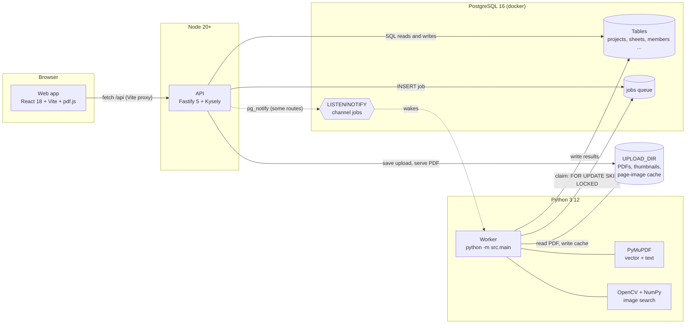

The API never calls the worker, and the worker never calls the API. They meet only in Postgres
and in the shared upload folder. The web app learns that work is done by **polling** the API.

**Tech stack**

| Part | Stack | Entry point |
|---|---|---|
| API | Node 20+, TypeScript, Fastify 5, Kysely + `pg`, Zod, ExcelJS | `api/src/server.ts`, routes registered in `api/src/app.ts` |
| Worker | Python 3.12, psycopg 3, PyMuPDF, NumPy, OpenCV (headless), Pillow | `worker/src/main.py` |
| Web | React 18, Vite, pdf.js (`pdfjs-dist`) | `web/src/main.tsx`, `web/src/components/Workspace.tsx` |
| Database | PostgreSQL 16 (`postgres:16-alpine`), plain-SQL migrations | `docker-compose.yml`, `db/migrate.ts` |
| Tests | Vitest (api, web), pytest (worker) | `Makefile` |
| Lint | ESLint + tsc + Prettier, Ruff | `Makefile` |

**Is Redis used? No.** No code or package ever used it, and the cleanup of 2026-11-04 removed
the `redis` service from `docker-compose.yml` and `REDIS_*` from `.env.example`. The queue is
the Postgres `jobs` table.

---

## 4. Repo structure

```text
.
├── api/                      Node API (Fastify)
│   └── src/
│       ├── server.ts         listen (PORT, HOST)
│       ├── app.ts            registers the route plugins
│       ├── routes/           one file per area (projects, build, review-ui, count, sessions ...)
│       ├── review/           business logic used by routes (actions, member-ops, tag-counter,
│       │                     image-similar, renumber-tags, line-first-bom, session-timing ...)
│       ├── catalog/          AISC shape lookup and import
│       ├── contract/ validator/ synthetic/ members/
│       │                     the member data contract (Zod -> schema/), its validator and a
│       │                     synthetic factory: kept for the later Tekla stage, not on the live path
│       ├── db/               Kysely client, types, test-database guard
│       ├── uploads/          streaming PDF upload (filename, sha256, size limit)
│       ├── scripts/          CLIs (catalog import, kind abbreviations, test-db, session export /
│       │                     report, lines backfill, schema generation)
│       └── __tests__/        Vitest tests (run against the *_test database)
├── worker/                   Python worker
│   ├── src/
│   │   ├── main.py           the loop and the handler registry
│   │   ├── queue.py          claim / complete / fail (the SQL queue)
│   │   ├── config.py         settings from .env
│   │   ├── pdf_scan/         scan_pdf: pages, sizes, scale text, thumbnails
│   │   ├── text_layer/  text_reader/   reading text (PDF text layer; outlined CAD-font glyphs)
│   │   ├── review/           auto_run, sheet_lines, copy_project, legend rows, line roles
│   │   ├── linking/          page lines and pen classes (lines, structural, candidates); the
│   │   │                     label linker (labels, rules) is used only by the measure / intake tools
│   │   └── build/            the Build engine (page.py) and its stages, auto mode, Find similar
│   ├── tests/                pytest
│   ├── measure/              the measurement core: held-out lock, prereg hashes, beam and
│   │                         column harnesses (section 19)
│   ├── tools/                ops and TEST-set intake tools (section 19)
│   └── prereg/               SHA-256 of each pre-registration document
├── web/                      React app
│   └── src/
│       ├── components/       ProjectsScreen, Workspace, Canvas, PageCard, FindSimilarBar, TagRenumber ...
│       └── lib/              api.ts (fetch), geometry, snapping, useSheetLines ...
├── db/
│   ├── migrate.ts            applies migrations in order (ledger: schema_migrations)
│   └── migrations/           001 ... 030, plain SQL, additive
├── schema/                   contract.v0.schema.json (generated by `make schema`)
├── fixtures/
│   ├── synthetic/            made-up test data (committed)
│   └── private/              real material, git-ignored, never committed
├── scripts/                  gitleaks install and scan
├── docker-compose.yml        Postgres 16
├── Makefile                  every common command
└── .env.example              settings template (copy to .env)
```

`docs/`, `CLAUDE.md` and every `*.md` file except `README.md` are git-ignored (`.gitignore`).
They exist on the owner's machine only.

---

## 5. Getting started

### Prerequisites

Linux (or WSL2), Docker with the compose plugin, Node 20+, [uv](https://docs.astral.sh/uv/),
make, and gitleaks (`./scripts/install-gitleaks.sh`).

### First time

```bash
cp .env.example .env      # replace every change_me value; set PORT=3100
make setup                # npm ci (root, api, web), Python 3.12 venv via uv, git hooks
make up                   # Postgres, waits until healthy
make migrate              # applies db/migrations/*.sql
```

### Run the three processes (three terminals)

> **Ports:** API on **3100**, web on **5180**. **Never use port 3000.** The code defaults
> are 3000 (API) and 5173 (web), so always set the ports as shown.

```bash
# 1. API (tsx watch: restarts itself on save)
PORT=3100 make api

# 2. Worker (does NOT reload: restart it after any Python change)
make worker

# 3. Web (Vite proxies /api to API_PROXY)
API_PROXY=http://127.0.0.1:3100 npm --prefix web run dev -- --port 5180 --strictPort
```

Open http://127.0.0.1:5180.

### Settings (`.env`, read by the API, worker and migrations)

| Setting | Used by | Default | Meaning |
|---|---|---|---|
| `DATABASE_URL` | API, worker, migrations | (required) | Postgres connection string |
| `POSTGRES_USER` / `POSTGRES_PASSWORD` / `POSTGRES_DB` / `POSTGRES_PORT` | docker compose | `5432` port | Database container settings |
| `PORT` | API | `3000` in code; **use 3100** | API port (`api/src/server.ts`) |
| `HOST` | API | `127.0.0.1` | API bind address |
| `API_PROXY` | web (Vite) | `http://127.0.0.1:3000` | Where Vite sends `/api` (`web/vite.config.ts`) |
| `UPLOAD_DIR` | API, worker | `<repo>/uploads` | PDFs, thumbnails, page-image cache |
| `MAX_UPLOAD_BYTES` | API | 524288000 (500 MB) | Upload size limit |
| `COLUMN_MODE` | API, worker | `click_first` | `click_first`: no automatic columns. `glyph`: the old glyph/grid/base-plate rules. (`api/src/review/settings.ts`, `worker/src/build/page.py`) |
| `FIND_SIMILAR_IMAGE` | API | on | `off`, `0`, `false` or `no` turns the image search off (vector only) |
| `CATALOG_EDITION` | API | latest imported | Which AISC catalog edition the review screen uses (`api/src/catalog/lookup.ts`) |
| `WORKER_POLL_INTERVAL_SECONDS` | worker | `2` | Longest sleep between queue checks |
| `WORKER_LOCK_TIMEOUT_SECONDS` | worker | `600` | When a "processing" job of a dead worker may be taken again |
| `WORKER_ID` | worker | `worker-<host>-<pid>` | Name written to `jobs.locked_by` |
| `GLYPH_FONT_ID` | worker | `default` | Glyph set for outlined text |
| `OCR_CROSSCHECK_ENABLED` | worker | `false` | Read into the config only: the app's text reading (`auto_run`) never runs OCR. The glyph CLI's `vote` uses OCR on its own (needs `make setup-ocr`) |
| `TEST_DATABASE_URL` | tests | `<DATABASE_URL db>_test` | Tests refuse any database whose name does not end in `_test` |

### Migrations

```bash
make test-db     # creates/migrates the *_test database first (idempotent)
make migrate     # then the real database: npm run migrate -> db/migrate.ts
```

`db/migrate.ts` takes an advisory lock, runs each new file once inside a transaction, and
records it in `schema_migrations`.

### Backup before every migration

```bash
mkdir -p ~/backups
docker exec estimation_postgres sh -c 'pg_dump -U "$POSTGRES_USER" -Fc "$POSTGRES_DB"' \
  > ~/backups/estimation_ai_$(date +%Y%m%d_%H%M%S).dump
```

Keep backups outside the repo. Restore with `pg_restore` into a new database first, to check it.

---

## 6. User workflow

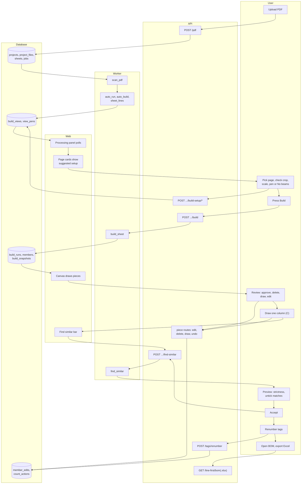

In words:

1. **Upload.** The worker scans the pages. Auto mode then suggests a setup for every page and prepares each page's lines.
2. **Setup.** For each page, check the role, crop, scale and beam pen, or choose **No beams**. Pick the column plan for a framing page.
3. **Build** the column plan first, then the framing pages.
4. **Review.** Approve, delete, draw and edit pieces. Every change is undoable.
5. **Columns.** Draw one column with **C**, then **Find similar**. Set the strictness, untick wrong matches, and press **Accept**.
6. **Renumber tags,** then open the **BOM** and **export Excel**.

---

## 7. Behind the scenes

### (a) Upload, scan, sheet lines and setup suggestions

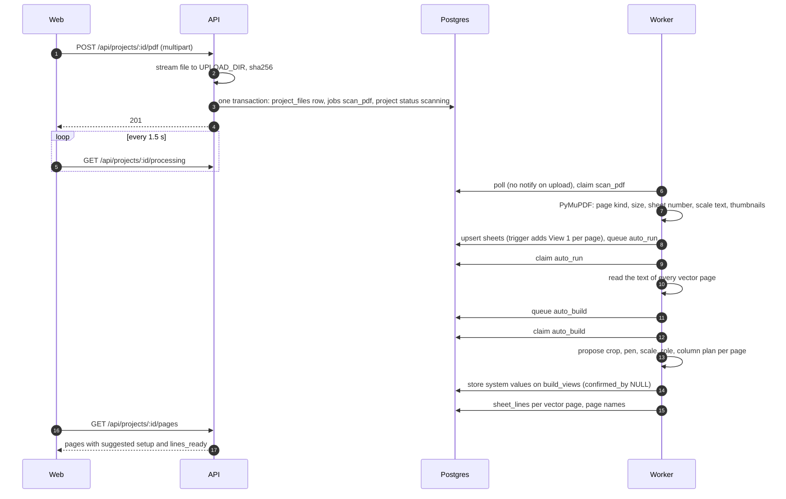

Code: `api/src/routes/projects.ts` (upload), `worker/src/pdf_scan/job.py`,
`worker/src/review/auto_run.py`, `worker/src/build/auto.py`, `worker/src/build/propose.py`.
If a page has no lines when it is opened, the web app calls
`POST .../sheets/:sheetId/lines/prepare`. That route queues `sheet_lines` and sends
`pg_notify` (`api/src/routes/count.ts`, `web/src/lib/useSheetLines.ts`).

### (b) Press Build on a framing page

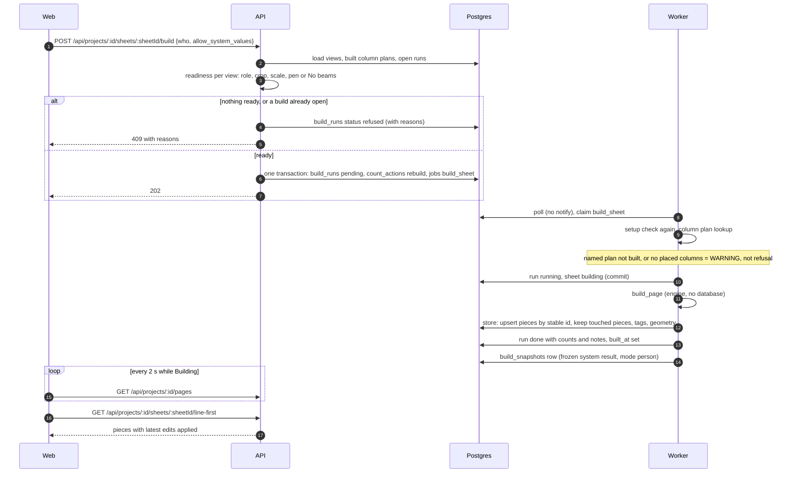

Code: `api/src/routes/build.ts`, `worker/src/build/job.py` (`build_sheet`, `store`),
`worker/src/build/page.py` (`build_page`), `worker/src/build/snapshots.py`.

### (c) Find similar

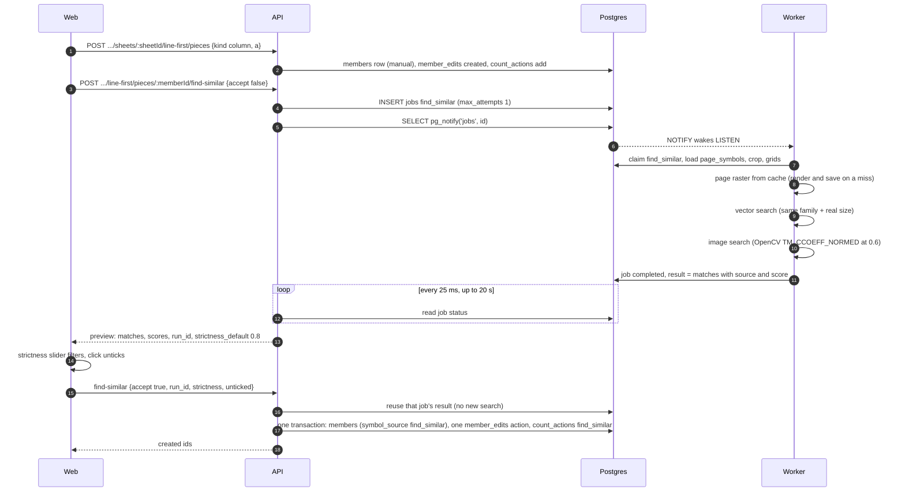

Code: `web/src/components/FindSimilarBar.tsx`, `api/src/routes/review-ui.ts`,
`api/src/review/image-similar.ts`, `worker/src/build/similar_job.py`,
`worker/src/build/col_image.py`. Accepted columns copy the drawn column's size (`profile`).
Because all of them are one action, one Undo removes them all.

### (d) Edit, delete, undo and the work-session trigger

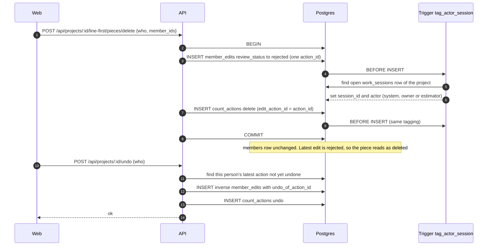

Code: `api/src/review/actions.ts` (`recordAction`), `api/src/review/member-ops.ts`
(delete entries, undo, redo), `api/src/routes/member-actions.ts` (`/undo`, `/redo`),
`db/migrations/027_work_sessions.sql` (the trigger). Undo is per person (keyed by `who`).
No row is ever deleted: the history is action, then undo, then redo.

---

## 8. Build engine

`build_page` in `worker/src/build/page.py` is pure: it takes a page and a `Setup` and returns
a `PageBuild`, with no database access. `build_sheet` and `store` in `worker/src/build/job.py`
do the reading and writing around it. Each run is stamped with
`RULES_VERSION = "phase12b-build-v1"` (`worker/src/build/__init__.py`).

```mermaid
flowchart LR
    S1["1. Segments<br/>vector paths in crop"] --> S2["2. Exclude boxes<br/>+ cleaning"]
    S2 --> S3["3. Grids<br/>+ crossings"]
    S3 --> S4["4. Column glyphs<br/>+ base plates"]
    S4 --> S5["5. Deselected lines"]
    S5 --> S6["6. Beam lines<br/>per pen, dashes"]
    S6 --> S7["7. Columns by role<br/>click-first"]
    S7 --> S8["8. Not beams<br/>walls, column edges"]
    S8 --> S9["9. Supports<br/>split into pieces"]
    S9 --> S10["10. Labels<br/>sizes"]
    S10 --> S11["11. Store: lengths,<br/>stable ids"]
    S11 --> S12["12. Tags"]
    S12 --> S13["13. States<br/>found / review / attention"]
```

This is the real order in the code. Dashed lines are handled inside the beam-line stage (6),
and walls are removed after the beam lines are made (8).

| # | Stage | File | Key settings |
|---|---|---|---|
| 1 | Parse vector paths into segments, clip to the crop | `segments.py` | `CURVE_SAMPLES = 8`, `JOIN_TOL = 0.05` |
| 2 | Exclude boxes; drop hatch, dimension and text strokes | `inputs.py`, `clean.py` | `TEXT_PAD_PT = 1.0`, `ARROW_MAX_PT = 10.0` |
| 3 | Grid bubbles, grid lines and crossings | `grids.py`, `page.py` | `GRID_MIN_LEN_PT = 150`, `GRID_GAP_PT = 12`, `GRID_EXTEND_PT = 24`, `DIRECTION_TOL_DEG = 10`, `MIN_CROSSINGS = 4` (page has a grid) |
| 4 | Column glyphs; grid end markers; base plates | `columns.py`, `base_plates.py` | `AT_GRID_PT = 30`, `REPEAT_MIN = 4`, `OFF_GRID_PT = 30` |
| 5 | Lines a person deselected | `inputs.py` | (person input) |
| 6 | Beam lines, one pass per beam pen; dash-pattern runs | `beam_lines.py` | `SOLID_GAP_MAX_PT = 24`, `MERGE_ANGLE_DEG = 1`, `BEAM_MIN_PT = 24`, `DASH_PATTERN_RUN_MIN = 5`, `DASH_PATTERN_SEG_MAX_PT = 40`, `DASH_PATTERN_SHARE = 0.8` |
| 7 | Columns by role and mode. Column plan, click-first (default): none automatic. Framing: columns placed on the plan page (registered) plus on this page | `page.py`, `register.py`, `col_symbols.py` | `COLUMN_MODE`, `REG_MIN_MATCHED = 2`, `REG_MAX_RESIDUAL_MM = 150` |
| 8 | Not beams: wall faces, column-shape edges, base-plate lines | `not_beams.py` | `WALL_MIN_IN = 4`, `WALL_MAX_IN = 24`, `WALL_PARALLEL_DEG = 2` |
| 9 | Supports: split beam lines at columns and girders | `supports.py` | `SNAP_COLUMN_PT = 12`, `NODE_MERGE_PT = 12`, `SNAP_BEAM_PT = 12`, `MIN_CROSS_ANGLE_DEG = 10`, `END_TRIM_PT = 12`, `MAX_ROUNDS = 20` |
| 10 | Size labels onto pieces and columns | `labels.py` | `PARALLEL_DEG = 10`, `LABEL_PERP_MAX_PT = 36`, `INFER_MAX_PT = 48`, `COLUMN_LABEL_MAX_PT = 60` |
| 11 | Lengths and stable ids (sha1 of page, kind, rounded ends) | `pieces.py`, `job.py` (`store`) | `MM_PER_PT = 25.4/72`, `STABLE_ROUND_PT = 1.0` |
| 12 | Tags: continue from the highest current tag of pieces that are not deleted | `job.py` (`assign_tags`, `take_tag_numbers`) | per project and prefix (`tag_counters`) |
| 13 | Piece state: `found`, `needs_review` or `attention`, from size state and support state | `pieces.py` (`build_state`) | undefined size or no support = attention |

**Rebuild rule:** a piece a person has touched (any edit, approval or count decision) is never
changed by a rebuild. A new piece that overlaps it is not added (`store` in `job.py`).

**Build flags and column modes.** The engine has no build flags any more. The Phase 13c flags
(F1 structural pen, F2 `wall_same_pen`, F3 main-grid crop, F4 stroke and off-grid columns) and the
Phase 14b column flags (`col_labels`, `col_similar`, `col_real_size`) were never passed by the app
and were removed on 2026-11-04 (they stay in the tag `archive/pre-cleanup-20261104`). The column
mode is `COLUMN_MODE` (`click_first`, the app's default, or `glyph`). Note: `Setup()` still
defaults to `glyph` for tests and harnesses; switching the default to `click_first` is a separate
later step with re-baselined tests.

---

## 9. Job system

**Queue a job:** one `INSERT INTO jobs (type, payload)`, usually in the same transaction as the
data it is about (for example the Build's `build_runs` row). See `api/src/routes/build.ts` and
`api/src/routes/projects.ts`.

**Claim a job** (`worker/src/queue.py`):

```sql
UPDATE jobs
SET status = 'processing', locked_at = NOW(), locked_by = %(worker_id)s,
    attempts = attempts + 1
WHERE id = (
    SELECT id FROM jobs
    WHERE attempts < max_attempts
      AND (status = 'pending'
           OR (status = 'processing'
               AND locked_at < NOW() - make_interval(secs => %(lock_timeout)s)))
      AND (%(types)s::text[] IS NULL OR type = ANY(%(types)s::text[]))
    ORDER BY created_at
    FOR UPDATE SKIP LOCKED
    LIMIT 1
)
RETURNING id, type, payload, attempts, max_attempts
```

**Wake-up:** the worker runs `LISTEN jobs` and waits on notifications for up to
`WORKER_POLL_INTERVAL_SECONDS` (2 s). Only three places send `pg_notify('jobs', id)`:
Find similar (`api/src/review/image-similar.ts`), lines/prepare (`api/src/routes/count.ts`)
and the lines backfill (`api/src/review/lines-backfill.ts`). Every other job, including
Build and upload, is found by the 2 s poll.

**Success and failure:**

- On success, `complete_job` stores `result` and sets `completed`.
- On an exception, `fail_job` stores `error`. The job goes back to `pending` while `attempts < max_attempts` (default 3), else it becomes `failed`.
- There is **no backoff**, so a retry can run at once.
- A job of a dead worker is taken again after the 600 s lock timeout.
- A refused Build is not a failure: it completes with `{"refused": [...]}`.
- Rows are never cleaned up.

| Job type | Queued by | Handler |
|---|---|---|
| `scan_pdf` | upload | `worker/src/pdf_scan/job.py` |
| `auto_run` | end of scan | `worker/src/review/auto_run.py` (reads the text, then queues auto mode) |
| `auto_build` | end of auto_run | `worker/src/build/auto.py` |
| `build_sheet` | `POST .../build` | `worker/src/build/job.py` |
| `sheet_lines` | lines/prepare, backfill (auto mode runs it in-process) | `worker/src/review/sheet_lines_job.py` |
| `find_similar` | find-similar preview (`max_attempts 1`) | `worker/src/build/similar_job.py` |
| `copy_project` | `POST /duplicate` | `worker/src/review/copy_job.py` |

The handler registry is in `worker/src/main.py`.

**Why Postgres as the queue**

| Gain | Cost (compared with BullMQ/Redis) |
|---|---|
| A job and its data are written in **one transaction** | No built-in delays, cron, priorities or backoff |
| Node produces and Python consumes; the queue is about 100 lines of SQL | No progress events or dashboard (the UI polls) |
| Low volume and one worker: Postgres is more than enough | Latency up to 2 s unless the route sends NOTIFY |
| Jobs are plain rows: easy to inspect and test | The table grows forever, with dead tuples from updates |
| One less service to run and back up | A crashed worker's job waits for the 600 s lock timeout |

---

## 10. Data model

Columns shown are the key ones only. FK = foreign key in the schema.

### (a) Core

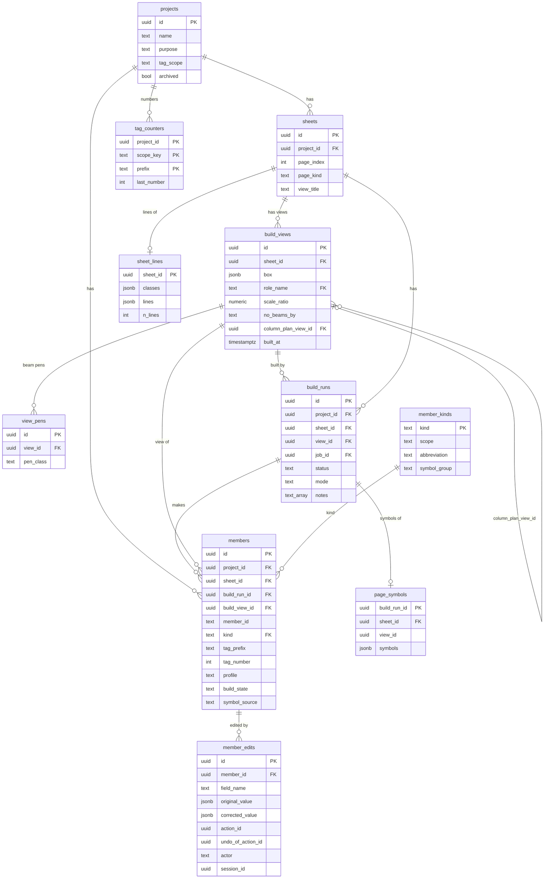

### (b) Audit, sessions and jobs

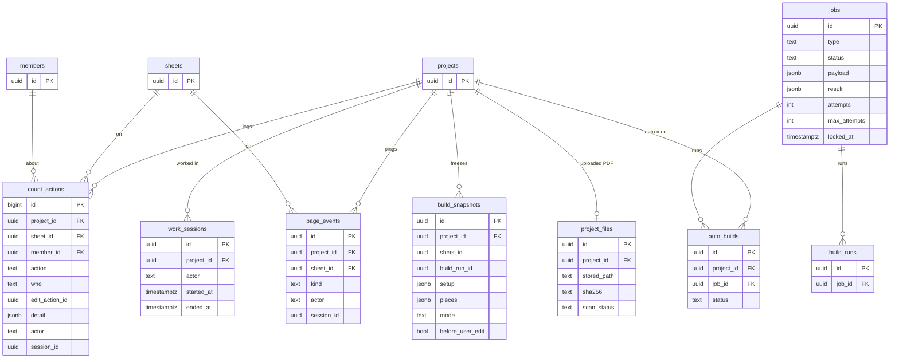

`session_id` and `actor` are set by a trigger, not by a foreign key. `jobs` rows link to their
data through ids in `payload`. `build_snapshots` has only the project FK on purpose, so that
nothing can change a snapshot through `ON DELETE SET NULL`.

### Tables

| Table | Purpose | Introduced in |
|---|---|---|
| `projects` | One estimating job and its settings | 001 |
| `sheets` | One row per PDF page: scan results, page names, a person's name and sheet number | 001 (scan 002, names 028, overrides 030) |
| `members` | Every piece (built, drawn or accepted) | 001 (build columns 016, symbols 029) |
| `member_edits` | Append-only person changes, grouped by `action_id` | 001 (`action_id` 005, actor/session 027) |
| `rate_table` | Pricing inputs (unused) | 001 |
| `catalog_shapes` | AISC shapes per edition | 001 |
| `jobs` | The work queue | 001 |
| `project_files` | The uploaded PDF of a project | 002 |
| `sheet_edits` | Append-only person changes to a page | 002 |
| `glyph_library` | CAD stroke-font glyph shapes and labels | 003 |
| `text_items` | Text read from a page | 003 (004) |
| `sheet_views`, `legend_rows` | Label-first views and legend rows (older path) | 005 |
| `project_grade_rules` | Grade per shape family, set only by a person | 008 |
| `member_kinds` | The scope list of kinds and tag prefixes | 010 |
| `sheet_lines` | Every vector line of a page with its pen class | 013 |
| `count_actions` | One row per person action (add, delete, undo, export ...) | 013 |
| `measurements` | Two-click measurements | 013 |
| `project_prefix_kinds` | Estimators' mark prefix mapped to a kind | 015 |
| `build_runs` | One row per Build press (also refused ones) | 016 |
| `grid_lines`, `support_nodes`, `beam_lines` | Build geometry | 016 |
| `auto_builds` | One auto-mode run per project | 017 |
| `build_snapshots` | Frozen system result of a Build | 017 (person builds 027) |
| `tag_counters` | Running tag number per project and prefix | 017 |
| `role_names` | Role names mapped to a build behaviour | 020 |
| `build_views` | The current setup: one or more views per page | 020 |
| `view_pens`, `view_exclusions`, `view_deselections` | Pens, exclude boxes, deselected lines of a view | 020 |
| `view_undo` | Before-state of an undoable view change | 021 |
| `work_sessions` | Start to End of a person's work | 027 |
| `page_events` | Activity pings for active time per page | 027 |
| `page_symbols` | Candidate column symbols of each column-plan Build | 029 |
| `schema_migrations` | Migration ledger | `db/migrate.ts` |

### Important triggers

| Trigger | Migration | What it does |
|---|---|---|
| `tag_actor_session()` on `member_edits`, `count_actions`, `sheet_edits`, `build_runs`, `members`, `view_*`, `measurements`, `page_events`, `build_snapshots` | 027 | BEFORE INSERT: sets `session_id` from the project's open work session and `actor` (`system`, else the session's actor, else `owner`) |
| `build_snapshots_frozen` | 017 | Blocks every UPDATE, and any DELETE while the project exists |
| `sheets_first_view` | 020 | AFTER INSERT on `sheets`: creates "View 1" in `build_views` |
| `set_updated_at()` on several tables | 001, 002, 003, 005, 020 | Keeps `updated_at` current |

### Migrations

| # | One line |
|---|---|
| 001 | Core tables: projects, sheets, members, member_edits, catalog, rate table, jobs |
| 002 | Uploaded PDF per project, page scan results, sheet edit history |
| 003 | Glyph library and text items (outlined text reader) |
| 004 | Text from the PDF text layer, scan evidence |
| 005 | Review screen: label-first views, legend rows, `action_id` on edits |
| 006 | Stroke classes of a view |
| 007 | Structural lines of a view |
| 008 | Grade rules per shape family (person only) |
| 009 | "These guesses are right" per sheet (flags) |
| 010 | Member kinds |
| 011 | Unique tag number for members with no prefix |
| 012 | Provisional tag prefix of a kind |
| 013 | Counting mode: count state, sheet lines, action log, measurements |
| 014 | Tag scope (job or sheet), sheet numbers |
| 015 | Typical multiplier, prefix-to-kind map |
| 016 | Line-first Build: build runs, grids, supports, beam lines |
| 017 | Auto mode, review UI, frozen snapshots, tag counters |
| 018 | Fix the `count_actions` action list |
| 019 | Archived projects |
| 020 | Build views, role names, several pens, exclusions, deselections |
| 021 | Undo for view changes |
| 022 | Approve members (action `approve`) |
| 023 | Piles kind and Pile plan role |
| 024 | Piles sort order |
| 025 | Project purpose (real, demo, evaluation), last opened |
| 026 | Project change action |
| 027 | Work sessions, actor and session tagging, page events, person snapshots |
| 028 | Page names, Section role |
| 029 | Column symbols, page symbols, Stud/Post kind, `find_similar` action |
| 030 | A person's page name (`name_override`) and sheet number (who and when) |

---

## 11. Lifecycles

### (a) Page / view setup and build

The badge rules are in `api/src/review/page-badge.ts`, and the checks run in that order.

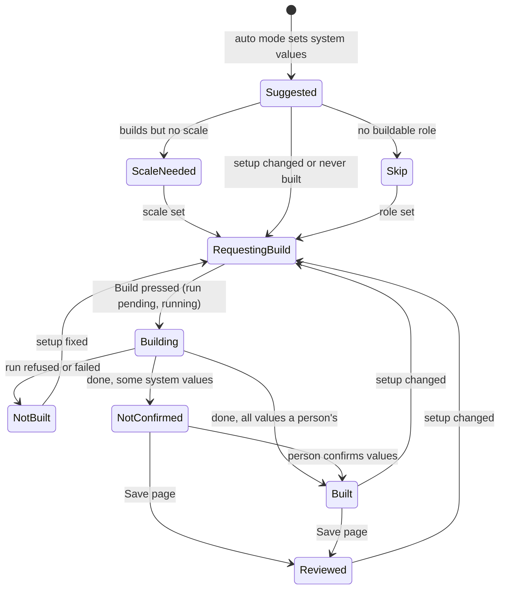

`build_runs.status` is `pending`, `running`, `done`, `failed` or `refused` (migration 016).

### (b) Piece review status

The effective value is the latest `member_edits` row. The stored `members` row is never changed
by a person (`api/src/review/members.ts`).

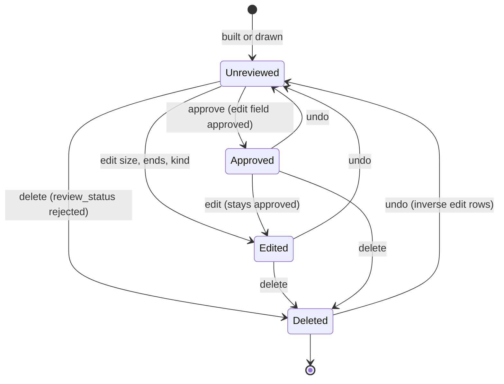

`members.review_status` allows `unreviewed`, `approved`, `edited` and `rejected`
(`rejected` = deleted). Undo writes new rows with `undo_of_action_id`. Redo is an undo of that
undo, allowed only while the person has done nothing newer.

### (c) Job status

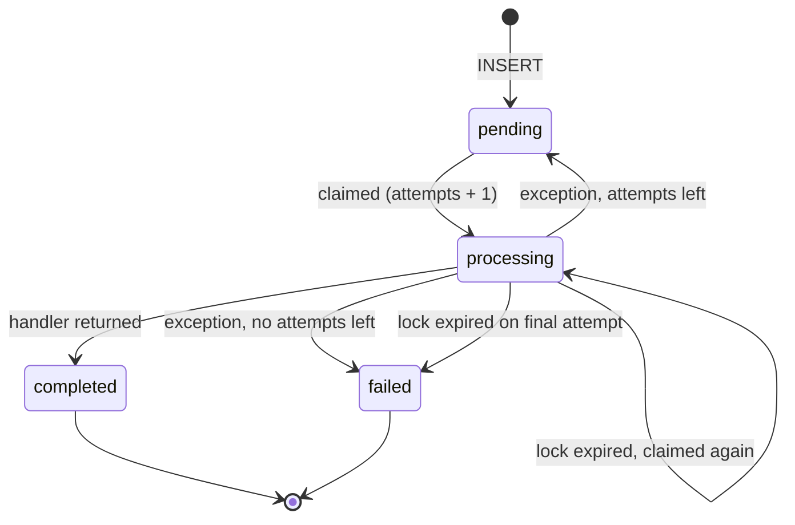

---

## 12. Main API routes

All routes are under `/api/projects/:projectId` unless shown otherwise. Files are in
`api/src/routes/`.

**Projects and pages**

| Route | Purpose |
|---|---|
| `POST /api/projects`, `GET /api/projects` | Create, list (`projects.ts`) |
| `GET`, `PATCH /api/projects/:projectId` | Read, rename, change purpose, archive |
| `POST .../pdf` | Upload the PDF; queues `scan_pdf` |
| `POST .../duplicate` | Copy as demo (`copy_project` job) |
| `GET .../processing` | Scan and auto-mode progress (`review-ui.ts`) |
| `GET .../pages` | Page cards: setup, badge, `lines_ready` |
| `GET .../sheets/:sheetId/thumbnail`, `GET .../pdf-file` | Images and the PDF for the viewer |
| `PATCH .../sheets/:sheetId/names` | A person's page name (null = the name read on the page) and sheet number (`sheets.ts`) |
| `POST .../sheets/:sheetId/lines/prepare`, `GET .../lines` | Prepare and read page lines (`count.ts`) |

**Setup**

| Route | Purpose |
|---|---|
| `POST .../sheets/:sheetId/build-setup/role` · `crop` · `scale` · `tos` | Set a setup value (`build.ts`). A crop can be anywhere on the displayed page ("Reset crop to full page" sends the whole page); `width_pt` / `height_pt` are already the displayed size, also on rotated pages |
| `POST .../build-setup/pick-pen` · `remove-pen` | Beam pens |
| `POST .../build-setup/no-beams` | No beams |
| `POST .../build-setup/column-plan` | Column plan link |
| `POST`, `PATCH`, `DELETE .../sheets/:sheetId/build-views[/:viewId]` | Add, change or delete a view (`build-views.ts`) |
| `.../build-views/:viewId/exclusions`, `/deselections/*` | Exclude boxes, deselected lines |
| `GET`, `POST /api/role-names` | Role names |

**Build**

| Route | Purpose |
|---|---|
| `POST .../sheets/:sheetId/build` | Press Build; queues `build_sheet` |

**Pieces and review**

| Route | Purpose |
|---|---|
| `GET .../sheets/:sheetId/line-first` | Pieces of a page, edits applied |
| `POST .../sheets/:sheetId/line-first/pieces` | Draw a piece |
| `POST .../line-first/pieces/edit` | Edit or approve one or many pieces |
| `POST .../line-first/pieces/delete` | Delete pieces |
| `POST .../line-first/pieces/:memberId/ends` | Move piece ends |
| `POST .../undo`, `POST .../redo` | Undo / redo the person's last action (`member-actions.ts`; the web has no Redo button yet) |
| `POST .../sheets/:sheetId/save-page` | Mark the page reviewed |

**Find similar**

| Route | Purpose |
|---|---|
| `POST .../line-first/pieces/:memberId/find-similar` | Preview (`accept: false`) or Accept (`accept: true`, `run_id`, `strictness`, `unticked`) |

**Tags**

| Route | Purpose |
|---|---|
| `GET .../tags/renumber` | Preview (writes nothing) |
| `POST .../tags/renumber` | Renumber as one undoable action |

**Sessions and timing** (`sessions.ts`)

| Route | Purpose |
|---|---|
| `GET .../session`, `GET .../sessions` | Open session, all sessions |
| `POST .../session/start`, `POST .../session/end` | Start / End |
| `POST .../sheets/:sheetId/page-event` | Activity ping |
| `GET /api/sessions/:sessionId/timing(.csv)` | Time per page |

**BOM, reports and export**

| Route | Purpose |
|---|---|
| `GET .../line-first/bom`, `GET .../line-first/bom.xlsx` | BOM and its Excel file (`build.ts`) |
| `GET .../report`, `GET .../report.xlsx` | System-vs-final report (`review-ui.ts`) |
| `GET /health` | Health check |

These are all the routes: every one is called by the web, except `POST .../redo` and
`GET /api/sessions/:sessionId/timing` (JSON). The label-first, counting-copilot, tables,
takeoff, old BOM, flags and text-items routes were removed on 2026-11-04 (tag
`archive/pre-cleanup-20261104`). Their tables stay in the database (no migration drops them).

---

## 13. Data and privacy rules

- **Never commit client drawings or real data.** Only `fixtures/synthetic/` is committed. Real material lives in `fixtures/private/` and `uploads/`, both git-ignored (as are `fixtures/MARKUPS/` and every `*.pdf` under `fixtures/`).
- **Ids only.** Tool output, logs, commits and reports use ids (project, job, sheet ids), never client, project, firm or file names.
- **No drawing content to third-party APIs.** The pipeline is local. The optional OCR cross-check is local and makes no network calls (`docs/SPEC.md` section 10, `docs/SECURITY.md`; both local only).
- **Held-out test lock.** `fixtures/private/markups/heldout_test.lock` lists the locked TEST jobs. `worker/measure/jobs.py` gives `dev_jobs()` and `test_jobs()`, and every shared loader returns DEV jobs only. A locked job is read only with `--include-test --prereg <existing pre-registration>`, which prints a warning. Without `--prereg`, the run stops.
- **Tests never touch the real database.** The test harnesses refuse any database whose name does not end in `_test` (`api/src/db/test-database.ts`, `worker/src/db.py`).
- **gitleaks** runs in the pre-commit hook (`.githooks/`) and with `make gitleaks`.

---

## 14. How we measure

- **Pre-registration hash.** Before a study, its plan is written in `docs/PHASE*_PREREGISTRATION.md` (local only). The plan's SHA-256 is committed in `worker/prereg/<NAME>.sha256`. `worker/measure/prereg.py verify` stops a run if the document changed. Git history shows the hash was committed before the tool.
- **Held-out lock.** Tuning uses DEV jobs only. TEST jobs are used only for pre-registered measures (see [section 13](#13-data-and-privacy-rules)).
- **Measurement tools** live in `worker/measure/` (section 19). They are read-only on the database. They call the app's own functions (`build_page`, `col_image.find_similar`), write versioned output under `fixtures/private/eval/`, and print counts only.
- **Frozen session exports.** `npm --prefix api run session:export -- --session <id>` copies one work session to `fixtures/private/sessions/<id>/` and makes the copy read-only. `session:report` reads only that copy. The export is the source for training and measurement from then on.

---

## 15. Testing and lint

Tests need the database: run `make up` first. They use the `*_test` database only.

```bash
make test-db                   # create / migrate the _test database
make test                      # all: api + worker + web

make test-api                  # npm --prefix api test        (Vitest)
make test-worker               # cd worker && .venv/bin/pytest
make test-web                  # npm --prefix web test        (Vitest)

# one file
cd api && npx vitest run src/__tests__/lines-prepare.test.ts
cd worker && .venv/bin/pytest tests/test_queue.py -q

make lint                      # all of the below
make lint-api                  # eslint --max-warnings 0, tsc --noEmit, prettier --check
make lint-worker               # ruff check + ruff format --check
make lint-web                  # tsc (typecheck)
```

---

## 16. Operations

| Task | How |
|---|---|
| **Ports** | API 3100, web 5180, Postgres 127.0.0.1:5432. **Never 3000.** |
| **Backup** | `pg_dump -Fc` before every migration ([section 5](#backup-before-every-migration)) |
| **Migrations** | Back up, then `make test-db` (the `_test` database first) and run the tests, then `make migrate` |
| **After a Python change** | Restart the worker (`make worker`). It does not reload. The API (`tsx watch`) and web (Vite) reload by themselves. |
| **Lines for old projects** | `npm --prefix api run lines:backfill -- --project <id>` (dry run, read-only), then add `--apply`. Real projects only. |
| **Look at the queue** | `SELECT type, status, count(*) FROM jobs GROUP BY 1, 2;` (read-only) |

**Process safety.** Only stop a process you started yourself and recorded (PID and command
line). Check the command line before you stop it. Never kill by name or pattern (no `pkill`,
no `pgrep -f`). Never stop the owner's API (3100), web (5180), worker or Postgres.

---

## 17. Known limits and roadmap

| Limit | Today | Plan |
|---|---|---|
| **Count once across floors** | Each page counts its own pieces. The same member shown on two pages is counted twice. | Decision log: address each member by level and grid, so the same address on two pages is one member, and "LEVELS 2-5 TYPICAL" multiplies |
| **Match lines** | TODO: confirm (not found in code or spec) | TODO: confirm |
| **Studs vs columns** | `Stud/Post` is its own kind (migration 029), counted apart from Column. It is found only from label words, or drawn by a person. | |
| **Column sizes / TYP** | Accepted Find similar columns copy the drawn column's size. TYP-note sizing (`typical_column_size`, `worker/src/build/page.py`) runs only on columns the Build finds itself, and in click-first mode it finds none. | TODO: confirm the plan |
| **Braces** | Brace kinds exist and can be drawn by hand. The Build has no brace detection. | The brace form from the original spec is not scheduled |
| **Beam classifier** | TODO: confirm (described as on hold; no classifier in the code today) | Decision log: a small line keep/delete classifier trained on review corrections |
| **Automatic columns** | Not used. `COLUMN_MODE=click_first` (default) makes no automatic columns. `glyph` keeps the old rules. | Click-first + Find similar |
| **Pricing** | Not built | |

---

## 18. Decision log and contributing

- **Decision log:** the bottom of `docs/SPEC.md`, section 13 (local only, git-ignored). Add an entry for every design decision.
- **Branches:** work on a local branch per phase (for example `phase14f-fixes`). The owner reviews and pushes. Nobody else pushes.
- **Commits:** the owner's name only. No `Co-Authored-By` or other AI trailers.
- **Rules in `CLAUDE.md`** (local only):
  - one phase at a time, with a short plan first;
  - no LLM calls in extraction, validation or pricing;
  - never invent pricing, catalog data or ground truth;
  - ask when the spec is unclear;
  - report only what was actually run;
  - follow the process-safety rule.
- **Migrations:** additive only. Back up first, and run on `_test` first.

---

## 19. Tools appendix

Run from `worker/` as `PYTHONPATH=. .venv/bin/python -m <module>`. All are read-only on the
database unless noted, and print ids and counts only.

**Measurement core (`worker/measure/`)**

| Module | What it is |
|---|---|
| `measure.jobs` | The held-out TEST lock: `dev_jobs()`, `test_jobs()`, `include_test_from_argv` (`--include-test --prereg <doc>`) |
| `measure.prereg` | `write` / `verify` the SHA-256 of a pre-registration document (`worker/prereg/*.sha256`) |
| `measure.p12c_lib`, `measure.p12c_eval` | The beam harness: the estimators' markups in page coordinates, one-to-one matching, failure table, gallery |
| `measure.p13a_pen` | The page loader the harnesses share (setup, text, plan of a DEV page) |
| `measure.p14b_columns` | The column measure library: `load` (DEV pages), `measure`, `pooled`, the gallery panel |
| `measure.p14d_columns` | The column harness: image + vector Find similar from one click, through the app's own `col_image.find_similar` |
| `measure.takeoff.*` | Loaders and geometry of the takeoff markups (`common`, `inventory`, `geometry_study`, `colour_study`, `prefix_inventory`, `tag_study`) |

None of the harnesses takes `--include-test` yet: running the locked TEST set needs a new,
pre-registered entry point built on `measure.jobs`.

**Ops and intake tools (`worker/tools/`)**

| Module | What it is |
|---|---|
| `tools.session_project` | A fresh project for an estimator session: a dry run by default; `--apply` creates it (refuses a PDF in the TEST lock) |
| `tools.audit_actions` | Who did what in which project |
| `tools.project_preview` | Row counts per table of one project |
| `tools.markups_intake` (+ `bbmeasure`, `takeoff.import_markups`, `takeoff.phase6c_trace`) | Intake of new estimator markups as a locked TEST set |

**API scripts (`npm --prefix api run ...`)**: `catalog:import`, `kinds:load-abbreviations`,
`test-db`, `session:export`, `session:report`, `lines:backfill`, `schema:generate`.

**Glyph library CLI**: `make glyph-sheets`, `glyph-export`, `glyph-import`, `glyph-summary`
(`worker/src/text_reader/cli.py`).

The phase study tools (Phases 4e to 14e) were archived on 2026-11-04: they are in the tag
`archive/pre-cleanup-20261104`, not in the tree.
